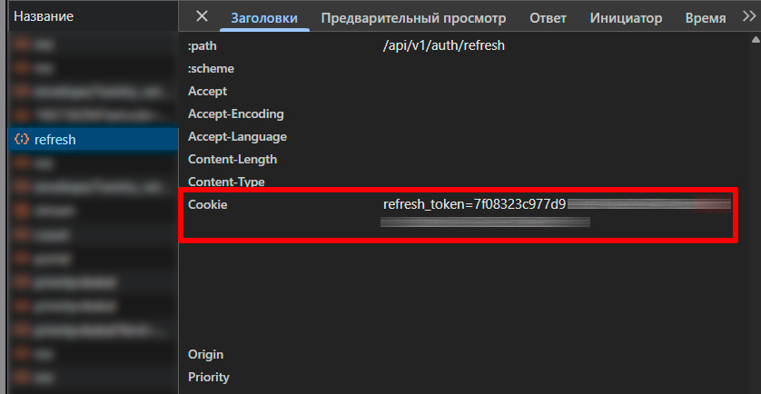
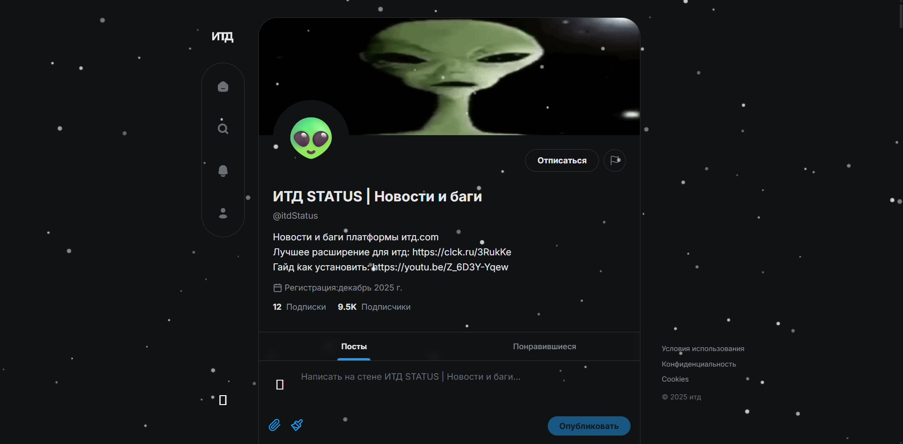

# ИТД v1.0.0 (старая версия)
Локальная копия более старой версии фронтенда [итд.com](https://xn--d1ah4a.com), используя живое API сайта.
## Требования
- [Node.js](https://nodejs.org/) v18 или новее
-----
## Установка и запуск
### 1\. Клонируй репозиторий
git clone https://github.com/itdPlus/ITD-v100
### 2\. Получение refresh\_token
Это токен сессии на сайте. Он нужен единожды для входа в аккаунт.

1. Открой [итд.com](https://xn--d1ah4a.com/) в браузере и войди в аккаунт
1. Открой DevTools (F12)
1. Перейди во вкладку **Сеть** и найди запрос **/refresh**
1. Пролистай ниже до значения refresh\_token и скопируй его в **config.js** (без refresh\_token=)

### 3\. **Открой config.js и вставь токен:**
### 4\. Запусти прокси
node proxy.js

Открой в браузере: **http://localhost:3000/feed**

-----
## Известные ограничения

Некоторые страницы недоступны из-за файлов, утерянных при сохранении архива:

- `/onboarding`
- `/register`
- `/hashtag/[tag]`

Если вы обладаете сохраненной копией старого ИТД, вы можете помочь этому проекту! Для связи пишите в тг: [@itdStatus](https://t.me/itdStatus)
